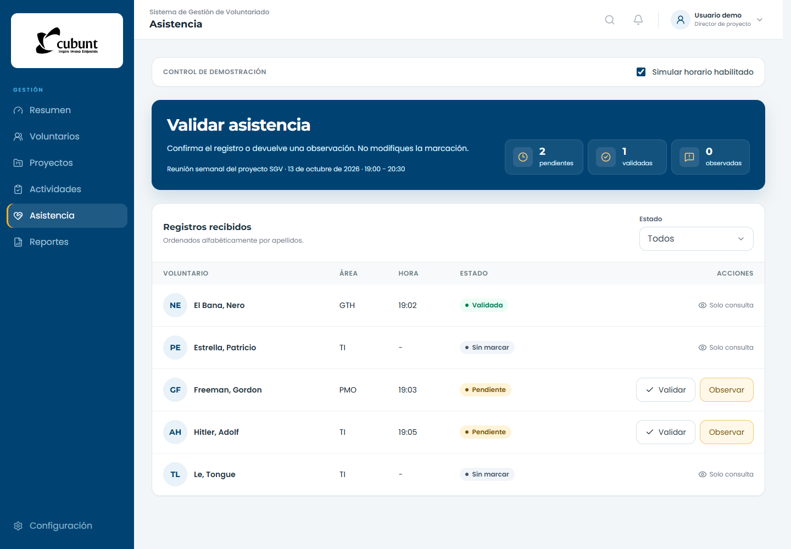

# SGV — Formato de asistencia

Prototipo frontend del Sistema de Gestión de Voluntariado de INCUBUNT para registrar, revisar y consultar asistencia a sesiones de proyecto.

## Funcionalidades

- Vista de voluntario con horario de sesión y estado de su registro.
- Vista de dirección para filtrar, validar y observar registros.
- Vista de Presidencia con indicadores y consulta de solo lectura.
- Navegación adaptable a escritorio, tableta y móvil.
- Confirmaciones de acciones y visualización del avance de registros.

## Vista previa



## Instalación

Requisitos: Git y Node.js 22.12 o superior compatible con Vite 8. El repositorio es privado y requiere acceso autorizado.

```powershell
git clone https://github.com/OleOle19/sgv-asistencia-sprint-2.git
cd sgv-asistencia-sprint-2
npm ci
npm run dev -- --port 5174
```

Abre http://localhost:5174. No requiere base de datos, claves ni archivo de entorno.

## Desarrollo y pruebas

| Comando | Uso |
| --- | --- |
| `npm run dev` | Servidor de desarrollo |
| `npm run build` | Validación de tipos y compilación |
| `npm run lint` | Revisión estática |
| `npm run prueba:funcional` | Pruebas de los tres roles y capturas |
| `npm run preview` | Vista previa de la compilación |

Las pruebas de navegador requieren el servidor activo en el puerto 5174 y Edge o Chrome instalado. Las capturas se generan en `docs/capturas`.

## Tecnologías y estructura

React, TypeScript, Vite, Tailwind CSS, Radix UI, Lucide y Sonner. Montserrat y Poppins se sirven localmente.

```text
src/componentes/  Estructura, controles y vistas
src/datos/        Sesión y registros de demostración
src/tipos/        Contratos de asistencia
public/marca/     Isologo institucional
scripts/         Pruebas de navegador
docs/            Documentación y capturas
```

## Alcance

El menú de usuario simula tres roles. El control de horario permite probar el estado de apertura de la sesión. Los cambios se mantienen en memoria y se restablecen al recargar.

No hay autenticación, autorización de servidor ni conexión a backend. Los avisos de confirmación indican acciones locales, no un guardado remoto. No debe utilizarse con información personal real.

## Colaboración

Trabaja en una rama y envía un pull request. Ejecuta la compilación, la revisión estática y las pruebas antes de solicitar revisión.

Consulta los [componentes visuales e interacciones](docs/ACTUALIZACION_VISUAL.md).
