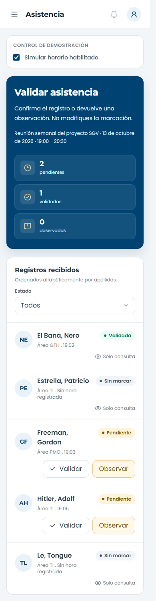

# Sprint 2: continuidad visual con el sprint 1

Los cambios ya están aplicados. Esta guía sirve para recorrerlos en orden y entender el código, sin volver a copiarlo sobre tu trabajo. Las rutas parten de `Vista de Formato de Asistencia (Sprint 2)`, sin una carpeta `aplicacion` adicional. Líneas verificadas el 10 de octubre de 2026; cambiarán si editas los archivos.

## 1. Ejecutar y ver el resultado

Abre la carpeta del sprint 2 en VS Code. En su terminal:

```powershell
npm install
npm run dev -- --port 5174
```

El servidor utiliza `http://localhost:5174`. Si ya está ejecutándose, no abras otra instancia. Usa el menú del usuario en la esquina superior derecha para cambiar entre Voluntario, Director de proyecto y Presidencia.


Se conserva la lógica de marcar, validar y observar asistencia. Los registros siguen siendo datos de demostración en memoria: recargar restablece el estado. No se conectó un backend ni se implementó autorización real; el selector solo simula vistas.

## 2. Estilos compartidos antes que pantallas

Ve a `src/estilos.css`, línea 39. `.tarjeta-sgv` centraliza fondo blanco, borde, esquinas y sombra de las tarjetas. Así las tres vistas usan el mismo tratamiento, sin repetir variantes visuales por pantalla.

En la línea 30, `scrollbar-gutter: stable` reserva el espacio de la barra de desplazamiento. En la línea 56, la regla para `body[data-scroll-locked]` evita compensar dos veces ese espacio cuando Radix bloquea el desplazamiento al abrir un menú. No borres una de ellas de forma aislada: trabajan juntas.

La línea 46 contempla `prefers-reduced-motion`. Las interacciones no deben depender de una animación para entenderse.

Montserrat y Poppins se mantienen. Azul y amarillo institucionales siguen siendo los colores principales; los colores de estado llevan su correspondiente texto.

## 3. La estructura que une las vistas

Ve a `src/componentes/EstructuraSGV.tsx`, línea 63. Aquí se construye la barra lateral de 244 px, la cabecera de 72 px y el contenedor principal, tomando el sprint 1 como referencia.

En la línea 64:

```tsx
const [menuMovilAbierto, establecerMenuMovilAbierto] = useState(false)
```

Este estado solo controla si el menú lateral del móvil está abierto. El rol viene de `Aplicacion`; no se crea otro estado de permisos dentro de la estructura. Radix Dialog gestiona el diálogo móvil, su cierre con Escape y el regreso del foco al botón que lo abrió.

El menú de usuario usa Radix Dropdown Menu y opciones de selección única. Elegir una opción llama a `alCambiarRol`; la estructura no decide cómo validar registros. Los enlaces de módulos todavía no implementados están deshabilitados, en lugar de aparentar navegación funcional.

El isologo completo de `public/marca/isologo-incubunt.svg` se conserva sin deformarlo ni añadir efectos. Su bloque blanco reserva espacio alrededor; no sustituimos el logo por un texto improvisado para copiar exactamente otra cabecera.

## 4. Crear primero las piezas pequeñas

Estas piezas ya existen dentro de `src/componentes`. Este es el orden útil para leerlas o reconstruirlas en otro ejercicio:

1. `Boton.tsx`, línea 24: concentra variantes y tamaños. El mismo componente resuelve acción principal, secundaria, observación e iconos; los botones mantienen sus eventos y restricciones originales.
2. `InsigniaEstado.tsx`, línea 10: combina punto de color y texto del estado. No dependemos únicamente de rojo, verde o amarillo.
3. `AvatarVoluntario.tsx`, línea 1: genera iniciales a partir del nombre y apellidos. Es decorativo, porque el nombre completo está escrito junto a él.
4. `TarjetaResumen.tsx`, línea 9: recibe icono, valor y etiqueta. Usa fondos sólidos, igual que la corrección del sprint 1, sin desenfoque de fondo que pueda producir franjas.
5. `CabeceraSeccion.tsx`, línea 11: unifica encabezado azul, título, explicación y zona opcional de métricas.
6. `Selector.tsx`, línea 11: envuelve Radix Select con el mismo diseño de los filtros del sprint 1. Recibe el valor y la función que lo actualiza; no guarda un valor paralelo que pueda desincronizarse.

Por ejemplo, la cabecera define los siguientes datos:

```tsx
interface PropiedadesCabecera {
  id: string
  titulo: string
  descripcion: string
  children?: ReactNode
  metricas?: ReactNode
}
```

`id` identifica el título para relacionarlo con su sección; `children` permite añadir información de la sesión y `metricas` insertar tarjetas. Ambas propiedades son opcionales: la vista de voluntario no necesita las mismas métricas que la de dirección.

## 5. Aplicar esas piezas sin reescribir la lógica

Ve a `src/componentes/VistaVoluntario.tsx`, línea 25. La sesión aparece en `CabeceraSeccion`; el registro personal y el horario utilizan tarjetas blancas compartidas. Se mantienen las condiciones de apertura y marcado.

Ve a `src/componentes/VistaDirector.tsx`, línea 57. El encabezado reúne pendientes, validadas y observadas con `TarjetaResumen`. En la línea 76, `Selector` cambia el filtro de estado. Los cálculos de `useMemo` y las funciones de observar/validar se mantienen separados de la presentación.

Ejemplo del patrón de composición:

```tsx
<TarjetaResumen
  icono={Clock3}
  etiqueta="pendientes"
  valor={String(pendientes)}
/>
```

`pendientes` ya se calcula a partir de los registros; `String` adapta el número a la propiedad de texto. El componente no recalcula asistencia: se encarga de presentarla. La tabla usa bordes por celda y avatares; en móvil los registros se muestran como tarjetas. Si un filtro no tiene coincidencias, se explica explícitamente.

Ve a `src/componentes/VistaPresidencia.tsx`, línea 26. Usa la misma cabecera y tarjetas, pero conserva la vista de solo lectura. El porcentaje muestra también una descripción textual de su nivel; no se añadieron botones de validación a este rol.

## 6. Mantener el estado en Aplicacion

Ve a `src/Aplicacion.tsx`, línea 11. Se mantiene `useState<RolVista>` para el rol simulado y `useState<RegistroAsistencia[]>` para el arreglo de registros. Las funciones actualizan ese arreglo y las vistas reciben los datos y eventos necesarios.

El ajuste de la línea 58 solo cambia el aspecto del control de demostración. No convierte el horario simulado en una regla de seguridad ni altera los datos que escribiste.

## 7. Verificar antes de seguir con otra tarea

Con la demo activa en el puerto 5174, ejecuta:

```powershell
npm run build
npm run lint
npm run prueba:funcional
```

La prueba funcional recorre los tres roles a 1440, 900 y 390 px, revisa desbordamientos, dimensiones, fuentes, apertura de menús, filtros, observación, validación y la vista de solo lectura. También genera capturas en `docs/capturas`. Requiere Edge o Chrome instalado; el script usa `playwright-core`.

Prueba además manualmente el menú móvil y sus opciones con teclado, el filtro sin resultados y la casilla de horario. Estas pruebas no equivalen a una auditoría completa de accesibilidad o a pruebas de un backend.



## 8. Qué no debes volver a instalar

No se incorporaron Swapy, GSAP, React Bits Pro o shadcn. Las primitivas nuevas son Radix Dialog y Radix Select; `package.json` y el archivo de bloqueo ya contienen las dependencias. Basta con `npm install` al clonar/copiar el proyecto.

Consulta [la revisión de herramientas y sus posibles usos](REVISION_HERRAMIENTAS_UI.md). Antes de añadir un componente, revisa su utilidad concreta, marca, licencia y compatibilidad con el proyecto compartido.
